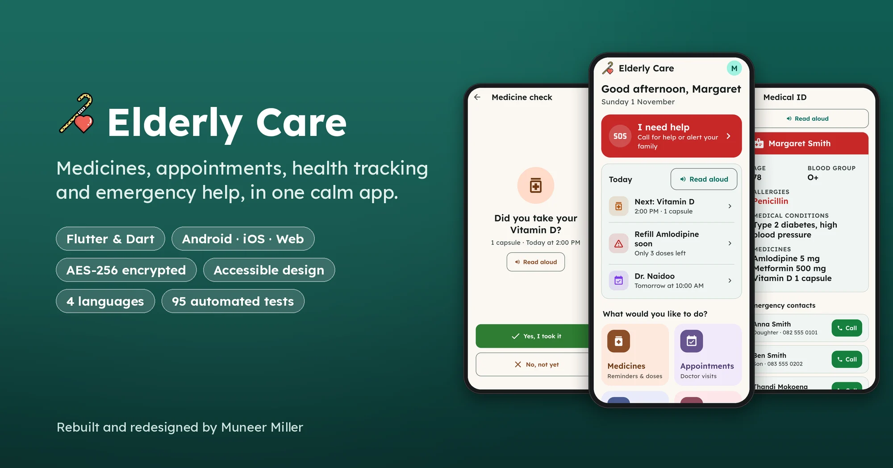
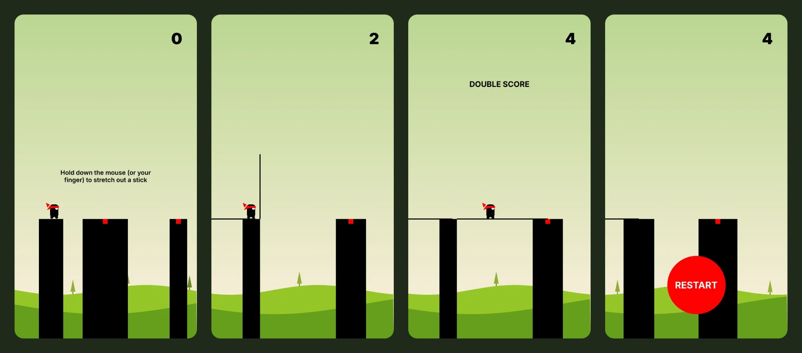

<h1 align="center">Hi, I'm Muneer Miller 👋</h1>

  <b>IT Support Technician & Software Developer</b> · Cape Town, South Africa 🇿🇦

  
  
  
  

---

I keep schools and businesses running on **Microsoft 365, Google Workspace** and their admin systems, and I build **software and Power BI reports** that make that work easier.

- 🏫 **Now:** Site Based Technician at **Baseline IT**, placed at Constantia Waldorf School, and the primary technical contact for the school's Ed-Admin system and its third-party integrations
- 📊 Building **Power BI** dashboards that give school administration data-driven insight
- 🎓 **NQF 5 IT: Systems Development** from [WeThinkCode_](https://www.wethinkcode.co.za/), plus IBM SkillsBuild Web Development Fundamentals
- 🧑‍🏫 Spent over a year as a **Learning Specialist at 2U**, tutoring full-stack web development (Node.js, React, SQL, MongoDB)
- 🤝 Open to IT support, systems and development work. [Say hello](mailto:muneermilleror@gmail.com)

## 🚀 Featured projects

<table>
  <tr>
    <td width="50%" valign="top">
      
      <h3><a href="https://github.com/MuneerMiller/WeThinkCode-Projects/tree/main/elderly_app-master">Elderly Care</a></h3>
      
A calm health companion for older people: one-tap SOS, medicine reminders with read-aloud, a blood pressure tracker, medical ID, nearby hospitals and a PIN or fingerprint lock.

      
Started as my solo WeThinkCode_ final project, since rebuilt for Android, iOS and the web, with AES-256 encrypted data, four languages (English, Afrikaans, isiZulu, isiXhosa) and 95 automated tests. Prepared for the App Store and Google Play.

      

        
        
        
      

      <b><a href="https://muneermiller.github.io/WeThinkCode-Projects/demo.html">▶ Try the live demo</a></b>
    </td>
    <td width="50%" valign="top">
      
      <h3><a href="https://github.com/MuneerMiller/StickHeroGame">Stick Hero</a></h3>
      
A one-button browser arcade game built from scratch with no dependencies. Hold to grow a stick, release to drop it, and walk the ninja across the gap.

      
A 60 fps time-based game loop, a state machine for each phase of play, procedurally generated levels with parallax scenery, and pointer events for mouse, touch and pen.

      

        
        
        
      

      <b><a href="https://muneermiller.github.io/StickHeroGame/">▶ Play it live</a></b>
    </td>
  </tr>
</table>

### More work

| Project | What it is | Built with |
| --- | --- | --- |
| [Login and Registration](https://github.com/MuneerMiller/login-json) | Sign-up and login with bcrypt-hashed passwords, session cookies, a protected dashboard and API tests | Node.js · Express · bcrypt |
| [Library Management System](https://github.com/MuneerMiller/Python-Library-Project) | Command-line app to lend, return and search books, with validation and a unittest suite | Python · SQLite |
| [Task List](https://github.com/MuneerMiller/Task-List-Application) | IBM SkillsBuild final project: a responsive, accessible to-do list that saves to the browser | HTML · CSS · JavaScript |
| [WeThinkCode_ projects](https://github.com/MuneerMiller/WeThinkCode-Projects) | My coursework in Python and Java: toy robot worlds, Mastermind, Hangman, recursion and more | Python · Java · Dart |
| [Social Media Tracker](https://github.com/MuneerMiller/Social-Media-Tracker) | Dashboard for social media stats with light and dark themes that follow the system setting | HTML · SCSS · JavaScript |
| [Sticky Slider Navigation](https://github.com/MuneerMiller/Responsive-Home-Sticky-Slider-Navigation) | Nav bar that sticks on scroll, smooth-scrolls to sections and slides an indicator under the active tab | HTML · CSS · JavaScript · jQuery |
| [Portfolio website](https://github.com/MuneerMiller/muneermiller.github.io) | My personal site and online CV | HTML · CSS · JavaScript |

## 🛠️ Toolbox

**IT & systems**

**Data & reporting**

**Development**

## 💼 Experience

| Role | Where | When |
| --- | --- | --- |
| **Site Based Technician** | Baseline IT · Constantia Waldorf School | Aug 2026 – present |
| **Remote Support Technician** | Baseline IT | Mar 2025 – Aug 2026 |
| **Learning Specialist** (full-stack tutor) | 2U, Inc. · remote | Jul 2023 – Oct 2024 |
| **Junior Software Developer** | Home Assist Technologies | Jun 2022 – Oct 2022 |

Full details are on my <a href="https://muneermiller.github.io/cv/">online CV</a>.

---

  <a href="https://muneermiller.github.io/">muneermiller.github.io</a> ·
  <a href="https://www.linkedin.com/in/muneer-miller">LinkedIn</a> ·
  <a href="mailto:muneermilleror@gmail.com">muneermilleror@gmail.com</a>

